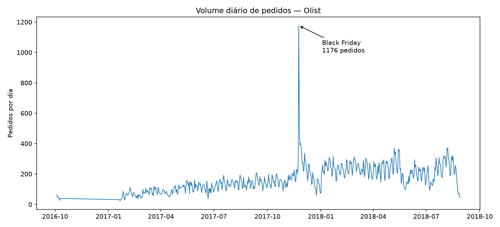
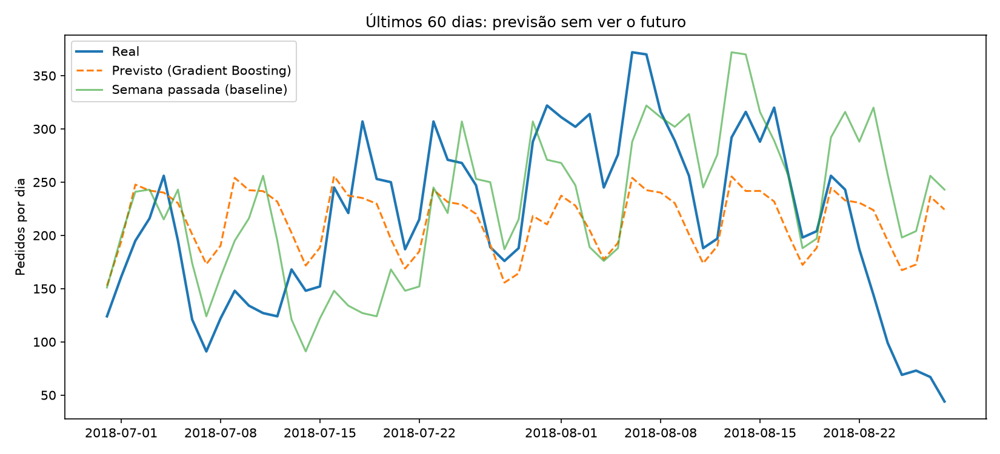

# Previsão de Demanda Diária — E-commerce (Olist)

Projeto de Machine Learning para prever o volume diário de pedidos de um e-commerce brasileiro, usando dados reais da Olist.

**Autor:** Rafael Simões · Estudante de Análise e Desenvolvimento de Sistemas (FMU), com experiência em operação logística (warehouse/fulfillment).

---

## O problema

Em uma operação de logística, saber quantos pedidos vão entrar amanhã muda tudo: quantas pessoas escalar, quantas docas abrir, como organizar a separação e a expedição. Errar pra menos gera atraso; errar pra mais gera custo com equipe parada.

O objetivo deste projeto é prever o **volume diário de pedidos** a partir da data, e medir o quanto essa previsão erra em dias que o modelo nunca viu.

## Os dados

- **Fonte:** [Brazilian E-Commerce Public Dataset by Olist](https://www.kaggle.com/datasets/olistbr/brazilian-ecommerce) (Kaggle)
- **Arquivo usado:** `olist_orders_dataset.csv` (cerca de 99 mil pedidos, de 2016 a 2018)
- Os pedidos foram agrupados por dia, gerando 597 dias de operação.
- Os dias das bordas do período (início e fim da coleta, com quase nenhum pedido) foram removidos, porque não representam a operação real.

> O CSV não está neste repositório. Para rodar o projeto, baixe o dataset no Kaggle e coloque o `olist_orders_dataset.csv` na pasta do projeto.

## O que os dados mostram

- **Tendência:** o volume cresceu de forma consistente ao longo de 2017 e 2018.
- **Padrão semanal:** os dias úteis concentram mais pedidos que o fim de semana.
- **Evento:** o maior pico foi em 24/11/2017, com 1.176 pedidos contra uma média de 128 por dia. É a Black Friday, quase 10 vezes o volume normal.



## Como o projeto evoluiu

Cada arquivo leva o número da semana de estudo em que foi feito, mostrando a evolução do raciocínio. A semana 2 não gerou script.

| Semana | Arquivo | O que foi feito | Erro médio (MAE) |
|---|---|---|---|
| 1 | `semana1_eda_olist.py` | Exploração dos dados | — |
| 3 | `semana3_train_test.py` | Primeiro modelo (regressão linear), com treino/teste e baseline | 60,5 pedidos |
| 4 | `semana4_comparar_modelos.py` | Árvore e Random Forest. Ficaram piores que o baseline (overfitting e falta de pista de tendência) | 61,3 pedidos |
| 4 | `semana4b_modelos_melhorados.py` | Correções: pista de tendência e limite de profundidade das árvores | 19,7 pedidos |
| 5 | `semana5_gradient_boosting.py` | Gradient Boosting contra Random Forest | 17,8 pedidos |
| 6 | `semana6_pipeline_validacao.py` | Pipeline e validação cruzada embaralhada em 5 rodadas | 21,7 pedidos |
| 7 | `semana7_validacao_temporal.py` | Validação temporal: treina só com o passado e prevê os 60 dias seguintes | **63,3 pedidos** |

**Baseline** das semanas 3 a 6 (prever sempre a média): 63,5 pedidos de erro. Os baselines da semana 7 estão em [Resultado final](#resultado-final).

## Resultado final

Na validação cruzada embaralhada (Semana 6), o Gradient Boosting errava **21,7 pedidos por dia**. Mas essa validação misturava os dias e deixava o modelo treinar com datas do futuro, algo impossível na operação real.

Na Semana 7, refiz o teste do jeito que funcionaria na prática: cada rodada treina só com o passado e prevê os 60 dias seguintes (5 rodadas, de nov/2017 a ago/2018).

| Modelo | Erro médio (MAE) |
|---|---|
| Semana passada (baseline: mesmo dia, 7 dias antes) | **53,3 pedidos** |
| Random Forest | 63,3 pedidos |
| Gradient Boosting | 67,5 pedidos |
| Média do passado | 93,4 pedidos |

**Resultado honesto:** nenhum modelo superou o baseline "mesmo dia da semana passada". Dois motivos aparecem nas rodadas:

- **Árvores não continuam a tendência.** Em 2018 o volume continuou crescendo, e o modelo não consegue prever valores acima do que viu no treino. Na rodada de jan–fev/2018, os modelos erraram cerca de 93 pedidos por dia, contra 35 do baseline.
- **Eventos fora do padrão.** Na 1ª rodada, que inclui a Black Friday, todos erraram muito (de 86 a 114 pedidos), porque o modelo nunca tinha visto um pico assim no treino.



*Última rodada (jul–ago/2018): o modelo acompanha o padrão semanal, mas fica abaixo dos picos. A queda nos últimos dias vem do encerramento da coleta de dados, não da operação.*

## O que aprendi

- **A pista certa vale mais que o modelo certo.** Só adicionar a pista de tendência (dias desde o início) fez a regressão linear cair de 61,3 para 29,3 pedidos de erro. Trocar de modelo trouxe ganhos bem menores.
- **Modelo potente sem controle decora.** A árvore de decisão sem limite de profundidade errou 96,3 pedidos, pior que o baseline, porque decorou os dias do treino (overfitting).
- **Sempre comparar com um baseline.** Sem ele, não dá pra saber se o modelo está ajudando de verdade.
- **Uma divisão de teste só não basta.** A validação cruzada mostrou um erro mais realista que o teste único.
- **Em série temporal, validação embaralhada engana.** Ao testar só no futuro, o erro foi quase 3 vezes maior que o da Semana 6, e o modelo deixou de bater um baseline simples. Esse é o número que importaria na operação.

## Limitações e próximos passos

- **Usar o passado recente como pista:** o volume de 7 e 14 dias antes, que já sozinho foi o melhor baseline.
- **Modelar a tendência à parte:** como as árvores não extrapolam, separar o crescimento (por exemplo, com uma regressão linear) e deixar a árvore prever só o que sobra.
- **Datas promocionais:** adicionar uma pista de Black Friday e outras datas de pico deve reduzir os maiores erros.
- **Fim da coleta:** os últimos dias da base já mostram queda causada pelo encerramento da coleta, e não pela operação.

## Como rodar

1. Instale as bibliotecas:
   ```
   pip install -r requirements.txt
   ```
2. Baixe o `olist_orders_dataset.csv` no Kaggle e coloque na pasta do projeto.
3. Rode qualquer arquivo, por exemplo:
   ```
   python semana7_validacao_temporal.py
   ```

## Tecnologias

Python · pandas · NumPy · Matplotlib · scikit-learn
